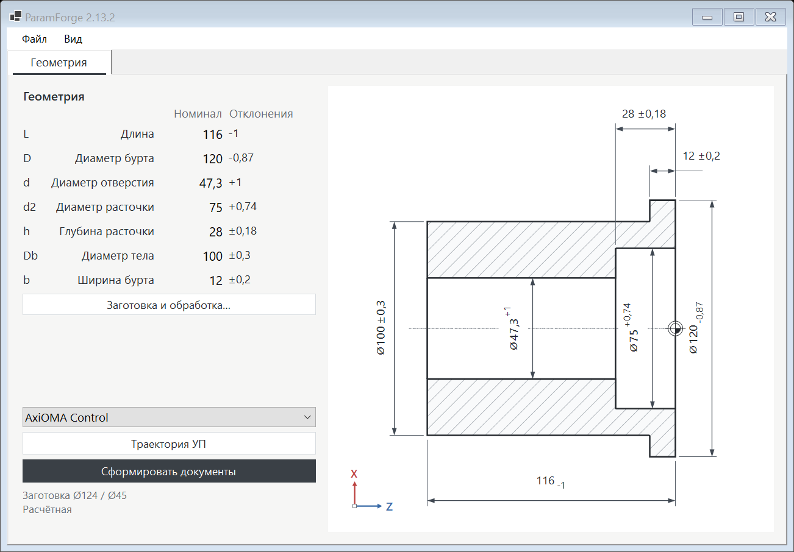

# ParamForge

Программа для расчёта втулки с буртиком, создания технологических карт и УП для AxiOMA Control и SINUMERIK.

**[Скачать для Windows x64](https://github.com/Elizar-H/ParamForge/releases/download/v3.0.0/ParamForge-3.0.0-win-x64.zip)**

Распакуйте архив целиком и запустите `ParamForge.exe`. Установка Qt и Visual Studio не требуется.

[Как открыть исходники и собрать проект](CONTRIBUTING.md).

