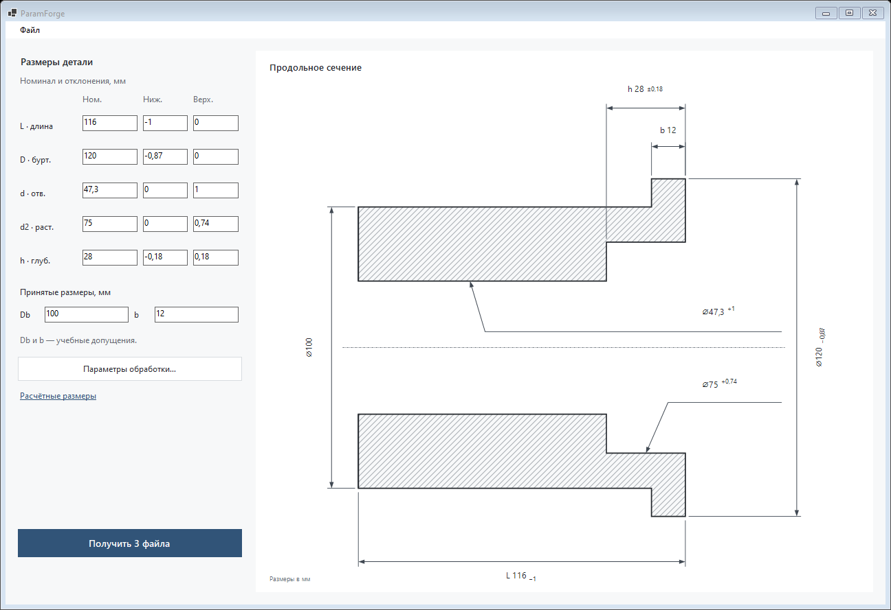

# ParamForge

Настольное приложение Windows для выбранной втулки с буртиком.

## Использование

1. Откройте `Запустить.cmd` или `release/ParamForge/ParamForge.exe`.
2. Введите размеры и отклонения. Чертёж обновится по введённым номиналам.
3. Нажмите **«Получить 3 файла»** и выберите папку.

В новой подпапке «Документы втулки» появятся только:

- `Маршрутная карта.docx` — МК на основе формы1 ГОСТ3.1118-82.
- `Технологическая карта.docx` — операционная карта010 на основе форм3/2а ГОСТ3.1404-86.
- `Управляющая программа.nc` — учебный код операции010.

Существующие файлы не перезаписываются. Параметры обработки доступны отдельной кнопкой; сохранение/открытие вариантаJSON — в меню «Файл». JSON не включается в комплект документов.

Диаметр тела100мм и ширина буртика12мм предложены для учебного примера. Пять остальных размеров и отклонения уточнены пользователем. Цель обработки — середина поля допуска; исходные номиналы и отклонения сохраняются. Сталь45,заготовка,инструменты и режимы требуют согласования. УП относится только к010; подготовка005,отделение/доводка020 и контроль030 остаются в маршруте внеУП. Исполнения на станке не было.

## Разработка

C#/.NET10,Windows Forms. Для запуска нужен .NET Desktop Runtime10; Python,Node.js,браузер и Word для генерации не требуются. Для сборки нужен .NET SDK10.0.402 (версия закреплена в global.json). Сборка: `scripts/build.ps1`. Тесты расчётов и структуры файлов: `dotnet run --project src/Kontur.Tests -c Release -- --report qa/tests.json`. Проверка собственной формы: `release/ParamForge/ParamForge.exe --smoke-output qa/ui`.

Визуальная проверка бланков выполняется отдельно в Word: структурные тесты не подтверждают вёрстку страниц. Графы с неподтверждёнными производственными сведениями и нормами остаются пустыми; полного производственного заполнения ЕСТД не заявляется.

Исходники подготовлены с помощью ИИ. Приватные исходные разговоры и текст ВКР хранятся вне репозитория. Commit/push без отдельного указания не выполняются.

