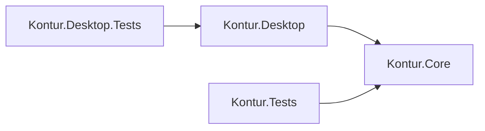

# Как устроен ParamForge

Начните с этого файла, если открываете исходники впервые. В [CONTRIBUTING.md](../CONTRIBUTING.md) описаны правила правки и команды проверки.

## На какие рекомендации опирается структура

Это модульное приложение WinForms с отдельным расчётным ядром. Такой выбор применяет разделение обязанностей и однонаправленные зависимости, описанные в [Architectural principles, Microsoft](https://learn.microsoft.com/en-us/dotnet/architecture/modern-web-apps-azure/architectural-principles). Статья рассматривает веб-приложения; здесь используются её общие принципы. Конкретные каталоги ParamForge — решение для этого проекта, а не обязательный стандарт Microsoft.

Для оформления приняты четыре пробела, скобки Allman, отдельная строка для каждого действия и понятные имена из [Common C# code conventions](https://learn.microsoft.com/en-us/dotnet/csharp/fundamentals/coding-style/coding-conventions). Правило одного основного типа в файле основано на [правилах организации исходников dotnet/runtime](https://github.com/dotnet/runtime/blob/main/docs/coding-guidelines/project-guidelines.md). Эти соглашения закреплены в [.editorconfig](../.editorconfig).

## Проекты и зависимости

Откройте `Kontur.sln` в Visual Studio или Rider. В решении четыре проекта:

| Проект | Ответственность | Зависит от |
|---|---|---|
| `Kontur.Core` | Параметры, расчёты, план обработки, УП, документы и JSON | Библиотеки .NET |
| `Kontur.Desktop` | Окна, элементы ввода, рисование и реакции на действия | `Kontur.Core` |
| `Kontur.Tests` | Регрессионные проверки расчётов и файлов | `Kontur.Core` |
| `Kontur.Desktop.Tests` | Проверки настоящих окон WinForms и снимки | `Kontur.Desktop` и его ядро |

Ядро не обращается к окнам и элементам управления. Проверки интерфейса не входят в исполняемую сборку программы. Они получают доступ к внутренним элементам через `InternalsVisibleTo`, поэтому ради проверок не пришлось делать их общедоступными.

Документы и файловые операции пока находятся внутри `Core` в отдельных каталогах. У них нет внешних зависимостей. Отдельный проект для каждого небольшого адаптера здесь не вводился.

Имена проектов и пространств имён `Kontur.*` сохранены для совместимости. Пользовательское имя приложения — ParamForge. Каталоги внутри проектов группируют обязанности; они не меняют имена типов и сохранённых полей JSON.

## От введённого размера до УП

1. `Desktop/MainWindow/MainForm.Inputs.cs` принимает действия в полях. `Parameters/ParameterDraftReader.cs` превращает текст в параметры. `NumericText.cs` отвечает за запятую, точку и отображение чисел.
2. `Core/Parameters/Tolerances.cs` разрешает стандартные отклонения, а `Machining/StockSelection.cs` — расчётную заготовку. `ParameterValidator.cs` проверяет допустимость параметров.
3. `Core/Engine.cs` координирует расчёт. `Machining/OperationCatalog.cs` составляет маршрут, `InspectionPlan.cs` — перечень контролируемых размеров и границ, `MachiningPlanBuilder.cs` — переходы и движения операции 010.
4. `NumericalControl/AxiomaPostprocessor.cs` или `SinumerikPostprocessor.cs` преобразует общий план в текст. `LinearPostprocessor.cs` выполняет общую нумерацию кадров и связывает их с переходами. Команды, заголовки и комментарии диалектов определены в соответствующем постпроцессоре.
5. `NumericalControl/Verification` независимо читает сформированный текст и восстанавливает движения. Общий модальный проверщик сохранён: копирование всего парсера для двух близких подмножеств усложнило бы сопровождение.
6. `Desktop/Inspection` показывает восстановленные движения и текст. `Core/Documents` формирует карты, `Persistence/ProjectFiles.cs` сохраняет параметры и выпускает комплект файлов.

Все пути в пунктах выше указаны относительно `src/Kontur.` с соответствующим именем проекта. Например, `Core/Engine.cs` означает `src/Kontur.Core/Engine.cs`.

## Где искать нужное изменение

| Нужно изменить | Начните с |
|---|---|
| Начальные размеры детали | `src/Kontur.Core/Models/Parameters.cs` |
| Название поля, диапазон и подсказку | `src/Kontur.Core/Parameters/ParameterSchema.cs` |
| Условия допустимости геометрии | `src/Kontur.Core/Parameters/ParameterValidator.cs` |
| Стандартные поля допусков | `src/Kontur.Core/Parameters/Tolerances.cs` |
| Подбор заготовки | `src/Kontur.Core/Machining/StockSelection.cs` |
| Инструментальные ограничения | `src/Kontur.Core/Machining/ToolingProfile.cs` |
| Порядок переходов и движения | `src/Kontur.Core/Machining/MachiningPlanBuilder.cs` |
| Команды конкретного ЧПУ | `src/Kontur.Core/NumericalControl/*Postprocessor.cs` |
| Чертёж и размерные надписи | `src/Kontur.Desktop/Drawing/SketchCanvas.Rendering.cs` |
| Перетаскивание размера | `Drawing/SketchCanvas.cs` и `MainWindow/MainForm.Dragging.cs` в Desktop |
| Панель выбора допусков | `src/Kontur.Desktop/Dimensions/DimensionEditor.cs` и `TolerancePicker.cs` |
| Вкладка и изображение траектории | `src/Kontur.Desktop/Inspection/ResultInspectionView.cs` и `Rendering/TrajectoryCanvas.Rendering.cs` |
| Разделы заготовки, обработки и их ввод | `src/Kontur.Desktop/Processing/ProcessingView.cs`, `ProcessingView.Navigation.cs` |
| Таблицы Word | `src/Kontur.Core/Documents/NativeDocxCards.cs` |
| Импорт JSON и защиту файлов | `src/Kontur.Core/Persistence/ProjectFiles.cs` |
| Проверку конкретного поведения | `Cases` в тестах ядра или `Scenarios` в проверках интерфейса |

## Как читать главное окно

`MainWindow/MainForm.cs` содержит состояние окна, запуск и подключение событий. Остальные части разделены по действиям:

- `MainForm.Layout.cs` — создание и размеры элементов.
- `MainForm.Inputs.cs` — поля номиналов и чтение черновика.
- `MainForm.Preview.cs` — предварительный вид и применение расчёта.
- `MainForm.Tolerances.cs` — открытие и применение боковой панели допусков.
- `MainForm.Dragging.cs` — начало, предварительное изменение и завершение перемещения.
- `MainForm.Errors.cs` — отображение ошибок рядом с полями.
- `MainForm.Navigation.cs` — переход от диагностического сообщения к нужному параметру.
- `MainForm.Windows.cs` — открытие и закрытие рабочих вкладок, применение настроек и согласование ЧПУ.
- `MainForm.Files.cs` — диалоги открытия, сохранения и выпуска.
- `MainForm.Diagnostics.cs` — внутренние точки доступа и снимки для проверок.

`partial` означает части одного класса WinForms. Он используется для связанного кода представления, а не как замена самостоятельным классам расчёта. Чтение параметров, форматирование чисел и технологические правила имеют собственных владельцев.

## Как читать проверки

`Kontur.Tests/Program.cs` — вход командной строки. `RegressionSuite.cs` запускает проверки и собирает отчёт; `RegressionSuite.Registration.cs` перечисляет наборы. `Cases` содержит проверки по функциям, `Support` — общие утверждения, независимое чтение УП, разбор Word и временные каталоги. Части `RegressionSuite` разделяют небольшой существующий исполнитель без подключения нового тестового фреймворка.

В `Kontur.Desktop.Tests` вход находится в `Program.cs`, общая последовательность — в `UiSmoke.cs`, вспомогательные действия — в `UiSmoke.Support.cs`, сценарии — в `Scenarios`. Имена сценариев описывают функцию; исторические номера в идентификаторах отдельных проверок сохранены для сравнения отчётов.

Количество строк не ограничено искусственным пределом. Например, вкладка проверки УП длиннее простого элемента ввода, но остаётся одной связной задачей. Основание для выделения класса — самостоятельная обязанность, которую можно назвать и проверить.

Развитие программы для других деталей описано в [PART_PROFILES.md](PART_PROFILES.md).
